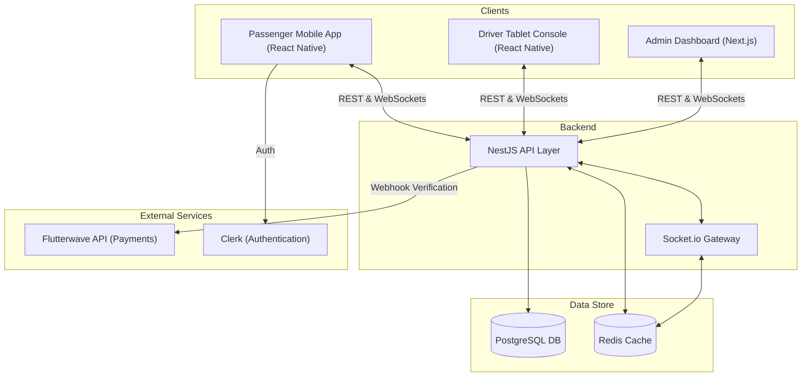

# RidesRus

RidesRus is a smart bus-hailing platform designed to modernize intra-city bus transportation for Lagos commuters. By combining the efficiency of ride-hailing with the scalability of bus systems, it enables real-time bus tracking, seamless cashless boarding, and optimized driver operations.

## Overview

The platform allows passengers to view available buses in real-time on a map, hail specific buses, board securely via QR code, pay seamlessly, and select their drop-off stops. Drivers use a mounted tablet console for passenger management and trip coordination, minimizing distractions while improving operational efficiency.

## Core Features

1. **Live Bus Tracking & Seat Availability**: Passengers view buses on an interactive map, color-coded by seat availability (white = empty, green = available, red = full).
2. **Bus Hailing**: Passengers can tap on a bus and request a hail, alerting the driver console.
3. **Secure QR Boarding**: Boarding and payments are authenticated through a passenger scanning a bus-specific QR code, which automatically updates seat counts and confirms the hail.
4. **Stop Selection**: After boarding, passengers select their drop-off stop. The system ensures drivers are notified of upcoming passenger drop-offs.
5. **Bus Console Dashboard**: Drivers interact with a tablet dashboard showing passenger counts, remaining seats, upcoming stops, and incoming hail requests.
6. **Trip Completion & Feedback**: Once dropped off, passengers receive a completion prompt and an option to provide feedback.

## System Architecture

The architecture is designed for real-time high-availability and low latency, essential for live GPS tracking and instant hail requests. 

### 1. Backend / API Layer
- **Framework**: NestJS (Node.js/TypeScript)
- **Real-time Engine**: `socket.io` for WebSockets (handling hails, GPS pings, bus movements, stop updates).
- **Database (Phase 2)**: PostgreSQL (via Supabase or AWS RDS) managed with Prisma ORM.
- **Cache / High-Frequency Data**: Redis (AWS ElastiCache or Upstash) to handle high-volume GPS pings without overloading the main database.
- **Payments Integration**: Flutterwave API for secure, seamless ticket deductions.

### 2. Frontend / Client Layers
- **Passenger Mobile App**: Built with React Native / Expo (TypeScript). Features mapping (transitioning to `react-native-maps`) and authentication (Clerk).
- **Driver Tablet Console**: React Native / Expo (TypeScript) application optimized for Android 10+ tablets with Kiosk Mode. It relies on an **Offline-First** architecture using `expo-sqlite` and optimistic UI updates to function reliably even in low-connectivity areas (e.g., Lekki-Epe Expressway).
- **Admin Dashboard**: Next.js with Tailwind CSS, including a Fleet Simulator to mock and monitor live fleet movements over WebSockets.

## Deployment Strategy

- **Backend Server**: Render (Dockerized NestJS) or AWS EC2.
- **Admin Dashboard**: Vercel (Edge network optimized).
- **Mobile Apps**: Compiled into standalone `.apk` and `.ipa` binaries using Expo Application Services (EAS).

## Key Objectives & Metrics

- Provide real-time bus visibility and automated passenger flow.
- Ensure 90%+ of passengers use the live map and successfully select stops.
- Maintain a high conversion of hails into successful boardings (>80%).
- Reduce driver distractions and missed hails to <10%.
